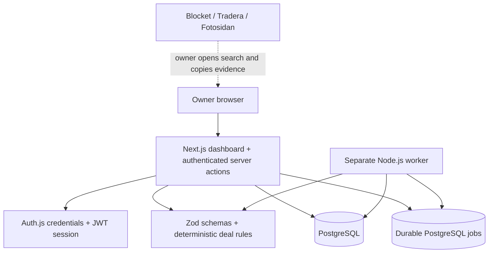

# X100VI Deal Tracker

A private workspace for finding a working Fujifilm X100VI for **strictly less than 15,000 SEK including delivery and required fees** across Blocket, Tradera and Fotosidan.

## What works today

This first build implements the app foundation, deal engine and manual owner workflow:

- Owner sign-in, persistent PostgreSQL storage and a separate background worker.
- Create and edit watches, including budget, selected marketplaces and approved collection locations.
- Import an individual listing URL with pasted details, seller claims and a delivery-cost breakdown.
- Validate camera generation, sale intent, condition, availability, price role and the full route cost.
- Inspect reasons and evidence, update an existing listing and retain its observation history.
- Re-evaluate an individual listing or a whole watch through persistent jobs.
- Responsive dashboard with filters, cost breakdowns and worker/run status.

**Automatic marketplace collection, recurring monitoring, notifications and deployment are the next phase.** Search now currently re-evaluates stored evidence and reports each selected source as requiring manual input. It never claims to have searched an inaccessible marketplace. Source search links open the marketplace for you.

Manual imports always remain **Needs review** (or Auction watch, Unavailable or Rejected). Their budget indicator can say below budget, but that is not source confirmation. Unknown costs are never treated as zero, and a current auction bid is never presented as a fixed purchase price. Checkout, bidding and seller communication stay on the original marketplace.

## Run locally

Prerequisites: Node.js **24.22.1** (`.node-version`), pnpm **11.25.0**, and Docker with Compose. A supported external PostgreSQL 17 instance can replace the local container. Enable the pinned pnpm through Corepack if available, or install that version using your normal package-manager setup.

```sh
pnpm install --frozen-lockfile
pnpm owner:setup
docker compose up -d db
pnpm db:migrate
pnpm dev
```

Open **http://localhost:3000**. Sign in with the owner email and password entered during setup. `pnpm dev` starts the web app and worker together. The database persists in a named Docker volume.

`pnpm owner:setup` prompts for an email and a hidden password of at least 12 characters. It writes a private, gitignored `.env` with a scrypt password hash, random session secret and random local database password. It refuses to overwrite existing configuration. Never use the placeholders in `.env.example` as real credentials.

For an external database, provision `.env` from `.env.example`, set `DATABASE_URL` and the owner/session configuration, and skip Docker. Run migrations before starting either process. Use TLS for remote database connections according to your provider's connection configuration; do not disable certificate verification.

### First use

1. Create a watch. The default total budget is 15,000 SEK, exclusive; either colour and cosmetic wear are acceptable.
2. Open a source search from the dashboard. Find an actual individual advert and select **Import listing**.
3. Paste its URL, title and description. Confirm what the listing states about the model, offer, functionality and availability.
4. Enter the displayed price and what it includes. Add shipping, buyer protection and other required fees. Leave unknown costs blank; use `0` only for an explicitly zero charge.
5. Inspect the result and evidence. Use **Update evidence** after you check the marketplace again. Re-importing the same source item in the same watch updates it rather than creating duplicates.
6. **Re-evaluate** runs the rules against stored facts. **Search now** does that for the watch. Neither refreshes evidence timestamps or fetches live marketplace pages in this build.

For collection, add the exact listed location to the watch's approved locations and provide a travel allowance. The calculator keeps collection and shipping routes separate. An inclusive source price must specify its scope to prevent double-counting fees.

## Architecture



| Directory         | Responsibility                                                                      |
| ----------------- | ----------------------------------------------------------------------------------- |
| `apps/web`        | Next.js App Router, owner authentication, forms and dashboard                       |
| `apps/worker`     | Persistent job processing and heartbeat; no automatic collectors yet                |
| `packages/domain` | Runtime input schemas, Swedish price parser, URL validation and evidence/cost rules |
| `packages/db`     | PostgreSQL schema, ownership checks, observations and durable job operations        |
| `scripts`         | Owner provisioning, migrations and isolated test setup                              |
| `tests`           | PostgreSQL integration and real-browser owner workflows                             |
| `docs`            | Full implementation specification and build decisions                               |

The worker claims queued work with `FOR UPDATE SKIP LOCKED`. Job execution and result updates commit together; a crash rolls the transaction back, leaving the job queued. Concurrent duplicate run requests coalesce into one active job. Re-evaluations preserve original evidence timestamps. Watch edits use revision checks and re-evaluate stored listings; stale listing-edit revisions are rejected.

Auth.js manages the credential/session flow and CSRF protection. All server mutations check the configured owner session and object ownership. The owner account is provisioned by the operator, with no public registration or email-based account recovery. Passwords use scrypt; sessions expire after eight hours; login attempts are throttled in PostgreSQL. Real email delivery and email-ownership verification are deferred with the notification integration.

## Checks and tests

```sh
pnpm lint
pnpm typecheck
pnpm test
pnpm build
```

Unit tests cover exact budget boundaries and öre precision, fee inclusion, unknown costs, model and advert validation, auction handling, freshness and source URL restrictions. They require neither a database nor internet access.

Database/browser tests use an **isolated local test database**, not your real watch data:

```sh
# Requires the local db container and the regular .env from setup.
pnpm test:setup
pnpm db:migrate:test
pnpm test:integration
pnpm exec playwright install chromium
pnpm test:e2e
```

Test setup creates `x100vi_test` and a gitignored `.env.test` containing an `@example.test` owner and random credentials. It only accepts a localhost database and refuses to overwrite existing test configuration. Integration and Playwright configs load that environment. Do not point either test suite at a live deployment. Browser tests start web and worker themselves; stop your ordinary dev server first. Tests never contact marketplaces or send notifications. If using a system Chromium, set `PLAYWRIGHT_CHROMIUM_EXECUTABLE` to its executable path.

Tests use synthetic item IDs and descriptions. Integration records are cleaned up; the isolated browser database retains its sample watch for inspection. Screenshots and failure traces remain in gitignored `test-results/`.

## Production build contract

```sh
pnpm build
pnpm db:migrate
pnpm start      # web process
pnpm worker     # separate long-running process
```

Run the web app and worker as independently supervised processes with the same environment and a persistent PostgreSQL database. Set `NEXTAUTH_URL` and `APP_BASE_URL` to the actual HTTPS origin before hosting, keep `NEXTAUTH_SECRET` stable, use HTTPS, and keep credentials in deployment secret storage. This change does not deploy the app or configure backups, retention jobs, mail delivery or monitoring; those remain release work.

## How we build next

1. Verify permitted access and actual query/detail formats for each marketplace; implement adapters one at a time with fixtures and visible manual fallbacks.
2. Add source-supported field evidence, fresh detail checks, fee-rule applicability and complete automatic route validation.
3. Add scheduling, source request budgets, source health and retry controls.
4. Add the notification outbox, verified email delivery and optional Telegram.
5. Deploy and complete operational checks, backups and data-retention/export/deletion controls.

The [implementation specification](docs/implementation-specification.md) defines the complete target. [Build decisions](docs/build-decisions.md) distinguish this first executable slice from later requirements.
