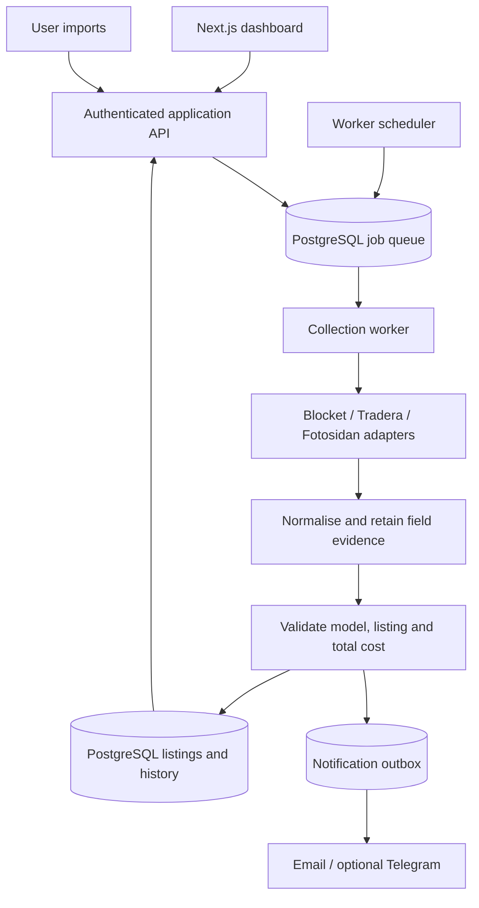

# X100VI Deal Tracker

Find a working Fujifilm X100VI for **strictly less than 15,000 SEK in total** across Blocket, Tradera and Fotosidan.

## Project status

This repository currently contains the product and implementation design. No application, collectors, schedules or notifications have been implemented or activated. The stack and commands below describe the planned build; they are not available yet.

Start with the [implementation specification](docs/implementation-specification.md), which defines source integration, search criteria, evidence validation, cost calculations, user controls, delivery and acceptance criteria.

## Goals

- Find new and updated listings across the three Swedish marketplaces.
- Distinguish an actual X100VI from older models, accessories, wanted ads and rentals.
- Include shipping and applicable buyer fees in the budget decision.
- Explain what is known, what is seller-reported and what still needs checking.
- Let the owner run a search on demand or enable scheduled monitoring.
- Deliver useful alerts with a direct listing link and a transparent cost breakdown.

The first release supports one owner, Swedish listings priced in SEK, either camera colour, and new or used working cameras. Cosmetic wear is acceptable. Checkout, bidding, seller messaging, additional marketplaces and international purchases are outside this release.

## How you will use it

1. Sign in and create the default X100VI watch with a 15,000 SEK exclusive total-cost limit.
2. Select Blocket, Tradera and Fotosidan. See whether each source supports automatic collection or needs manual input.
3. Choose email alerts, optionally pair Telegram, and send a test notification.
4. Press **Search now** for a single run, or **Enable monitoring** for recurring runs. Saving a watch alone does not start monitoring.
5. Review results in **Within budget**, **Needs review**, **Auction watch**, or **Over budget**. Each result includes evidence, timestamps and cost components.
6. Open the original listing, verify the camera and final terms, and complete any purchase on the marketplace yourself.

If a source cannot be collected automatically, use **Open source search** and **Import listing**. That source remains visibly manual; a run never pretends it searched an inaccessible marketplace.

## Proposed architecture



- **Web:** TypeScript, Next.js and a responsive dashboard.
- **Worker:** a separate Node.js process for durable jobs, source collection, validation and notification delivery. It continues when the browser is closed.
- **Storage:** PostgreSQL for watches, jobs, listings, evidence, observations and delivery state. Use a PostgreSQL-backed queue such as pg-boss; no Redis required for the first release.
- **Adapters:** source-specific query construction and parsing behind a common interface. Use documented APIs if available and approved; otherwise permitted public pages. Unsupported access falls back to user imports.
- **Validation:** deterministic rules and integer money arithmetic. AI/OCR is an optional later enhancement, never a requirement for budget qualification.
- **Delivery:** dashboard history plus email, with Telegram as an optional phone alert channel.
- **Hosting:** web process, persistent worker and managed PostgreSQL. A deployment that only hosts static pages or request handlers is insufficient for recurring collection.

## How we build

Implement in small vertical slices; the detailed exit criteria are in the specification.

| Phase | Deliverable |
| --- | --- |
| 0. Verify integrations | Record permitted access, supported filters, sample fields and manual fallback for all three sources. Do not assume API access. |
| 1. Core engine | Typed watch/listing contracts, evidence records, Swedish price parser, model validation and strict budget calculation, verified with fixtures. |
| 2. Owner workflow | Authentication, watch settings, manual imports, Search now and per-source run status. |
| 3. Source adapters | Implement and qualify Blocket, Tradera and Fotosidan independently. Preserve visible manual mode for unsupported sources. |
| 4. Background monitoring | Durable jobs, source request budgets, pause/resume, retries and fresh-data checks. |
| 5. Alerts and release | Transactional outbox, email, optional Telegram, end-to-end checks and honest coverage reporting. |

### Planned source layout

```text
apps/web/                 Dashboard and application API
apps/worker/              Scheduler, collectors and notification delivery
packages/domain/         Types, validation rules and cost engine
packages/sources/        Source adapters and fixture parsers
packages/db/             Schema and migrations
tests/fixtures/          Sanitised source samples and rule cases
docs/                    Product and implementation specifications
```

### Development setup to provide during implementation

Use a supported Node.js LTS release, pin its exact version, pin pnpm in `packageManager`, and commit a lockfile. Provide Docker Compose for PostgreSQL and an `.env.example` without secrets. Choose and lock dependency versions during scaffolding.

The scaffold must make this command contract work:

```sh
pnpm install --frozen-lockfile
docker compose up -d db
pnpm db:migrate
pnpm dev
pnpm lint
pnpm typecheck
pnpm test
pnpm test:e2e
pnpm build
```

`pnpm dev` must start both web and worker. Tests use fixtures and stubbed delivery by default; they must not repeatedly query live marketplaces or send real alerts.

Planned configuration includes `DATABASE_URL`, `APP_BASE_URL`, `OWNER_EMAIL`, an authentication secret, mail transport credentials, and optional Telegram credentials. See the specification for trust boundaries and configuration behaviour. Credentials stay in local environment files or deployment secret storage and must never enter git.

## Release standard

An eligible listing must be a likely working X100VI offered for sale, available for the owner's chosen delivery route, with all required costs supported by fresh evidence and a total below the limit. Seller claims remain labelled as claims. Unknown shipping is not free, an auction bid is not a purchase price, and failed collection is not zero results.

All three sources must pass either their automatic-adapter qualification or their explicitly tested manual fallback before release. The dashboard must report actual coverage. Fully automatic monitoring across all three is only achieved once every source has a verified automatic access path.

## Design references

The specification records the external references reviewed on 8 November 2026 and the integration questions still open. Marketplace UI, access rules and fees must be rechecked during implementation.
